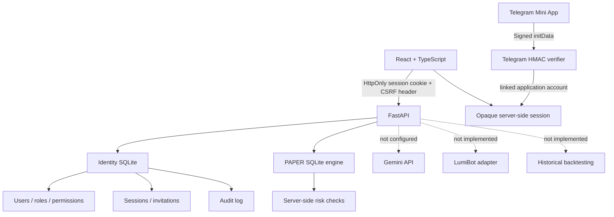

# Architecture — BOTVEX AI Trader 0.3.1

## Identity boundary

The current application uses FastAPI with SQLite-backed identity tables and a separate SQLite PAPER ledger. Passwords are Argon2id hashes. The browser receives a random opaque session cookie (HttpOnly) and a separate CSRF cookie; only the session token hash is stored in the database. The initial owner is created by an interactive CLI command, and a separate local-shell recovery command revokes owner sessions and forces password rotation. Server-side role/permission and account-state checks run for protected routes. Telegram `initData` is verified using the configured bot token and is linked to an existing application account; it never independently grants OWNER/ADMIN.

The identity database currently creates `users`, `roles`, `permissions`, `user_roles`, `role_permissions`, `sessions`, `invitations`, `audit_logs`, and `telegram_accounts`. Schema setup is idempotent with a small forward migration for `sessions.last_seen_at`. This is **not** a replacement for a versioned Alembic migration system.

## PAPER boundary

`backend/app/services/paper_trading.py` owns a transactional SQLite store. Accounts, positions, orders and risk settings are partitioned by authenticated application user ID. Order mutations use `BEGIN IMMEDIATE`; `(owner_id, idempotency_key)` is unique. Orders fill immediately at the user-supplied reference price and are labeled as simulated. The simulator does not contact a broker or market-data provider.

The kill switch, max order/position notional checks, sell-quantity checks, fee accounting and daily realized-loss limit are checked server-side. The daily-loss check covers realized losses on sells only; unrealized loss, slippage, partial fills and exchange-specific rules are not modeled.

## Current limitations

- SQLite persistence is intended for local/single-instance MVP use; PostgreSQL/Alembic are not implemented.
- Login throttling is persisted atomically in SQLite (`login_attempts`) and shared across workers using the same identity DB.
- Activation and reset links require manual secure delivery; email delivery is not configured.
- Gemini, LumiBot execution, broker integration, market data and historical backtesting are not implemented.
- No production deployment or Telegram WebView E2E verification has been performed.
